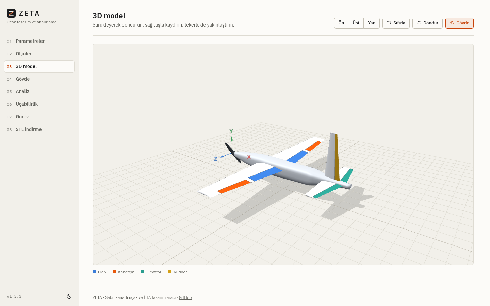
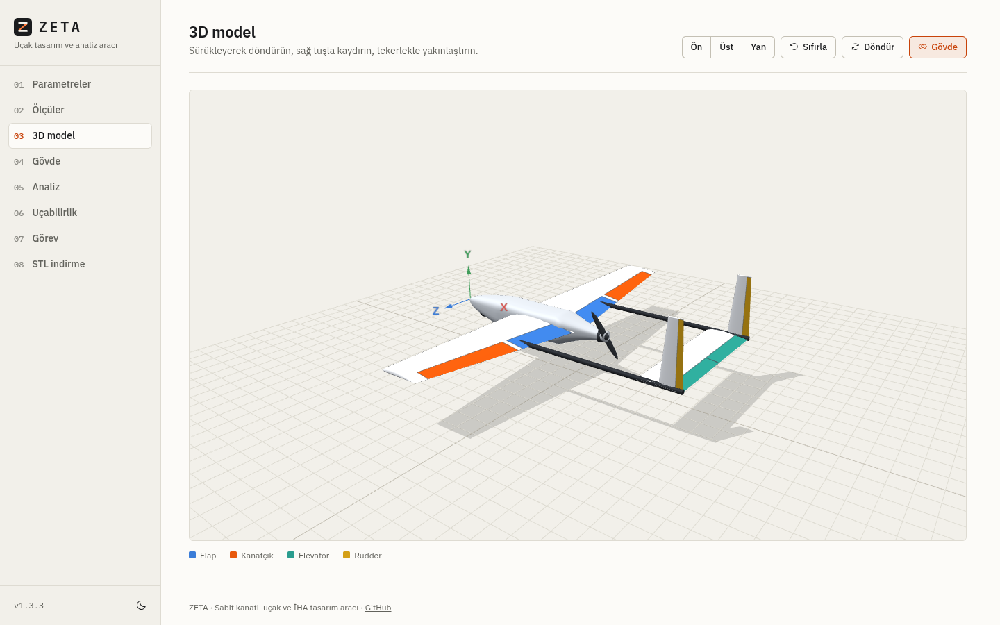
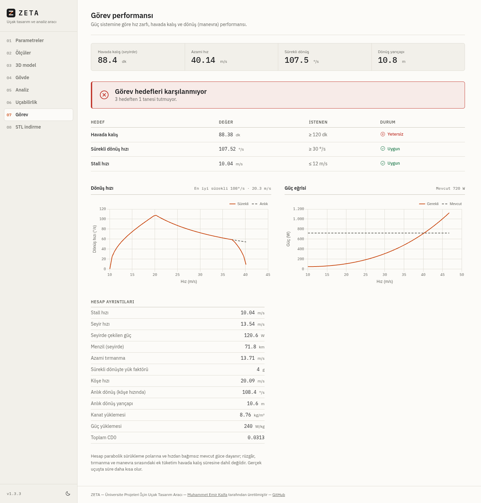

<p align="center">
  <picture>
    <source media="(prefers-color-scheme: dark)" srcset="docs/logo-dark.svg">
    
  </picture>
</p>

<p align="center"><strong>Sabit kanatlı model uçak ve yarışma İHA'ları için tasarım, analiz ve 3D baskı aracı</strong></p>

<p align="center">
  <a href="https://github.com/emirkalfa/zeta/releases"></a>
  <a href="https://github.com/emirkalfa/zeta/actions/workflows/ci.yml"></a>
  
  <a href="LICENSE"></a>
</p>

ZETA, kanat açıklığı ve ağırlık gibi birkaç temel değerden yola çıkarak bir uçağın geometrisini hesaplar, lifting-line teorisiyle aerodinamik analizini yapar, uçabilirliğini ve görev performansını değerlendirir, 3D modelini gösterir ve 3D yazıcı için STL dosyaları üretir. Üniversite projeleri ve Savaşan İHA gibi sabit kanat yarışmalarına hazırlanan takımlar için tasarlanmıştır.



## İndir ve çalıştır

Kurulum gerektirmeyen paketler [Releases](https://github.com/emirkalfa/zeta/releases/latest) sayfasındadır. Python kurmanıza gerek yoktur ve uygulama internet olmadan çalışır.

| İşletim sistemi | Dosya | Çalıştırma |
|-----------------|-------|------------|
| Windows 10/11 | `ZETA-<sürüm>-windows-x64.exe` | Çift tıklayın |
| Linux (x86_64) | `ZETA-<sürüm>-linux-x86_64.AppImage` | `chmod +x ZETA-*.AppImage` sonra çift tıklayın ya da terminalden çalıştırın |
| macOS (Apple Silicon) | `ZETA-<sürüm>-macos-arm64.zip` | Zip'i açın, `ZETA.app`'i Uygulamalar'a taşıyın |

Uygulama varsayılan tarayıcınızda açılır; sekmeyi kapattığınızda kendiliğinden kapanır. Yeniden çift tıklarsanız çalışan kopya açılır.

Paketler imzasız olduğu için ilk açılışta işletim sistemi uyarı gösterir:

- **Windows:** "Windows kişisel bilgisayarınızı korudu" penceresinde *Ek bilgi* ve ardından *Yine de çalıştır*.
- **macOS:** uygulamaya sağ tıklayıp *Aç* seçin ve çıkan pencerede yeniden *Aç* deyin.
- **Linux:** AppImage açılmıyorsa `libfuse2` eksik olabilir; `./ZETA-*.AppImage --appimage-extract-and-run` ile FUSE olmadan çalışır.

İndirdiğiniz dosyayı `SHA256SUMS.txt` ile doğrulayabilirsiniz.

## Kaynak koddan çalıştırma

Tek gereksinim **Python 3.10+**. Başlatma betiği ilk çalıştırmada sanal ortamı (`.venv`) kurar, bağımlılıkları yükler ve uygulamayı tarayıcıda açar; sonraki çalıştırmalarda doğrudan başlar.

```bash
# Linux / macOS
./start.sh

# Windows (çift tıklayarak da çalışır)
start.bat
```

[uv](https://docs.astral.sh/uv/) kuruluysa betiğe gerek yok:

```bash
uv run app.py
```

| Seçenek | Açıklama |
|---------|----------|
| `--port 8080` | Farklı port (varsayılan 5000; doluysa sonraki boş port seçilir) |
| `--host 0.0.0.0` | Ağdaki diğer cihazlardan erişim (varsayılan yalnızca bu bilgisayar) |
| `--no-browser` | Tarayıcıyı otomatik açma |
| `--desktop` | Tarayıcı sekmesi kapanınca sunucuyu da kapat (paketlerde varsayılan) |

Elle kurmak isterseniz: `pip install -r requirements.txt && python app.py`

## Nasıl kullanılır

Uygulama sekiz adımdan oluşur; ilk adımda **Hesapla**'ya basınca diğerleri açılır.

| Adım | Ne yapar |
|------|----------|
| **01 Parametreler** | Açıklık, ağırlık, profiller, kanat şekli/konumu, kuyruk ve gövde tipi, ağırlık merkezi, güç sistemi ve görev profili. Manuel modda kanat ve kuyruk ölçüleri elle girilebilir. |
| **02 Ölçüler** | Hesaplanan kanat, kuyruk, gövde ve kontrol yüzeyi ölçüleri. |
| **03 3D model** | Kontrol yüzeyleri işaretli, döndürülebilir uçak modeli. |
| **04 Gövde** | Atlas, Seyir ve Akın gövde modelleri; canlı genişlik/yükseklik ayarı ve özgün kesit düzenleme. |
| **05 Analiz** | Kaldırma eğrisi, sürükleme poları, moment, verim ve açıklık boyunca kaldırma dağılımı. |
| **06 Uçabilirlik** | Stall hızı, tırmanma ve statik kararlılık kriterleriyle uçabilir/uçamaz kararı. |
| **07 Görev** | Azami hız, havada kalış, menzil ve dönüş performansı; yarışma hedefleriyle karşılaştırma. |
| **08 STL indirme** | Kanat, kuyruk ve gövdeyi tek parça ya da dilimli olarak indirme. |

Girilen değerler tarayıcıda saklanır ve sayfa yeniden açıldığında geri yüklenir. Açık ve koyu tema vardır.

### Gövde koleksiyonu

Gövde adımındaki **Atlas**, **Seyir** ve **Akın** kartları özgün, parametrik ZETA modelleridir.
Atlas geniş ekipman hacmi, Seyir ince oval hatlar, Akın ise belirgin üst omuz çizgisi sunar.
Genişlik ve yükseklik %70–%150 arasında ayarlanabilir; seçim ve oranlar tarayıcıda saklanır.
**Kanat ve kuyruğu göster** ile gövdeyi tek başına veya uçak üzerinde inceleyebilirsiniz.
**Kesitlerle düzenle**, seçili modeli dokuz düzenlenebilir kesite dönüştürür; eski altı kesitli projeler de açılır.

Ana 3D görünüm, gövde önizlemesi ve STL aynı gövde yüzeyini kullanır. Üst kapak rengi yalnızca görsel bir ayrıntıdır;
STL kesintisiz bir kabuktur, sökülebilir kapak veya bağlantı elemanı içermez.
Gövde oranları bu sürümde aerodinamik, kütle merkezi ve görev hesaplarını yeniden modellemez.
Bu modeller üretim ve uçuş doğrulaması yapılmış uçaklar değil, düzenlenebilir ön tasarımlardır.

## Yarışma İHA'ları (Savaşan İHA vb.)

Parametreler adımında görev profilini **Yarışma İHA'sı** yapınca uçak, klasik model uçaktan farklı bir yerleşimle boyutlandırılır:

- **İtici pervane ve boş burun:** motor kısa gövdenin arkasındadır; burun, hedef takibi kamerası için ayrılır.
- **Çift bom:** kuyruk, kanada bağlı iki karbon boruyla taşınır. Bom uzunluğu ve çapı Ölçüler adımında verilir.
- **Kuyruk:** bomlar arasında dikdörtgen yatay kuyruk ve ikiz dikey kuyruk. Kuyruk tipi V seçilirse bomları birleştiren ters V kuyruk kullanılır.
- **Manevra için boyutlandırma:** daha düşük açıklık oranı (6) ve daha büyük kanatçıklar.



Aynı adımda motor gücünü, batarya enerjisini, aviyonik tüketimini ve yapısal yük faktörü sınırını girin. **Görev** adımı şunları hesaplar:

- **Hız zarfı:** stall, seyir ve güçle sınırlı azami hız; azami tırmanma oranı
- **Havada kalış ve menzil:** seyir hızında, bataryanın %80'i kullanılarak, aviyonik tüketimi dahil
- **Dönüş performansı:** sürekli dönüş hızı ve yarıçapı (stall, yapısal ve güç sınırlarının en küçüğüyle), köşe hızında anlık dönüş
- **Hedef kontrolü:** havada kalış, dönüş hızı ve stall hızı için kendi belirlediğiniz hedeflerle karşılaştırma



Hedeflerin varsayılan değerleri (20 dk, 30 °/s, 12 m/s) yalnızca başlangıç noktasıdır; güncel yarışma şartnamesine ve takım stratejinize göre düzenleyin. "Örnek yarışma İHA'sı değerlerini yükle" düğmesi 2 m açıklıklı, 5 kg'lık, 1200 W motorlu ve 6S 10 Ah bataryalı bir başlangıç tasarımı doldurur.

STL çıktısında ikiz dikey kuyruk tek parça olarak verilir ve iki kez basılır; bomlar basılmaz, karbon borudan kesilir.

Model idealdir: parabolik sürükleme poları (profil sürüklemesine gövde ve kuyruk için 0,015 eklenir), hızdan bağımsız mevcut güç ve %60 toplam tahrik verimi varsayılır. Rüzgâr, tırmanma ve manevra tüketimi hesaba katılmadığından gerçek havada kalış süresi daha kısadır.

## 3D baskı için STL

- **Kanat, içi boş ve iskeletli:** dış kabuk ayarlanan duvar kalınlığındadır; açıklık boyunca rib'ler iç boşluğu bölmelere ayırır. Rib'lerde ana (veterin %28'i) ve arka (%62'si) spar delikleri bulunur; karbon boru ya da çubuk bu deliklerden geçirilerek iskelet oluşturulur. Rib aralığı, rib kalınlığı ve delik çapları ayarlanabilir.
- **Dilimli çıktı:** büyük parçalar yazıcı tablasına sığacak şekilde eşit parçalara bölünür. Kanat dilimlerinin iki ucunda rib vardır ve parçalar spar üzerinde hizalanır.
- **Gövde:** otomatik hesaplanan konvansiyonel gövde ya da altı kesitle tanımlanan özgün gövde.
- **Kuyruk:** yatay ve dikey kuyruk (ya da V-kuyruk panelleri), duvar kalınlığıyla içi boş.
- Dosyalar milimetre ölçeğindedir. Duvar kalınlığı 0 girilirse parçalar dolu katı olarak üretilir.

İndirme sonrası rib sayısı ve spar'ın kökten ne kadar uzandığı bildirilir; spar borusunu buna göre kesebilirsiniz.

## Hesap yöntemleri

| Konu | Yöntem |
|------|--------|
| Geometri | Açıklık oranı, daralma ve kuyruk hacim katsayılarına dayalı klasik boyutlandırma; konik, dikdörtgen ve düz firar kenarlı kanat |
| Profil | Sekiz NACA profili (0012, 0015, 2412, 2415, 4412, 4415, 6412, 23012); ince profil teorisi, Reynolds sayısına bağlı `cd_0`, `cl_max`, `cm_0` |
| Kanat analizi | Lifting-line teorisi (Fourier serisi), ok açısı düzeltmesi, stall sonrası model |
| Kararlılık | Nötr nokta ve statik marj; açıklık oranına bağlı downwash |
| Görev | Parabolik polar ile gerekli güç, hız zarfı, havada kalış ve dönüş performansı |

Uçabilirlik kriterleri:

| Kriter | Uygun | Sınırda | Yetersiz |
|--------|-------|---------|----------|
| Stall hızı | < 10 m/s | 10–15 m/s | ≥ 15 m/s |
| Tırmanma oranı | > 2 m/s | 0–2 m/s | ≤ 0 |
| Statik marj | %5–%20 MAC | > %20 | < %5 |

Sonuçlar ön tasarım içindir; ayrıntılı tasarım ve uçuş güvenliği için doğrulanmalıdır.

## API

| Uç nokta | Metot | Açıklama |
|----------|-------|----------|
| `/api/airfoils` | GET | Profil listesi |
| `/api/airfoil/<id>` | GET | Profil ayrıntısı ve koordinatları |
| `/api/airfoil_props/<code>` | GET | Profil özellikleri (`?Re=` ile) |
| `/api/calculate` | POST | Geometri hesabı |
| `/api/analyze` | POST | Kanat polarları ve kaldırma dağılımı |
| `/api/stability` | POST | Uçabilirlik testi |
| `/api/mission` | POST | Görev performansı |
| `/api/version` | GET | Sürüm bilgisi |
| `/healthz` | GET | Sağlık kontrolü |

## Geliştirme

```bash
pip install -e ".[dev]"
pytest                          # 160+ test
python scripts/smoke_test.py    # uygulamayı başlatıp uç noktaları dener
node --test tests/test_fuselage.cjs  # gövde ölçüleri, yüzey eşleşmesi ve kapalı STL ağları
FLASK_DEBUG=1 python app.py     # otomatik yeniden yüklemeli geliştirme sunucusu
```

Masaüstü paketi üretmek için:

```bash
pip install -e ".[build]"
python packaging/build.py       # dist/release/ altına AppImage, .exe ya da .app
```

Her push ve PR'da testler üç işletim sisteminde çalışır ve paketler derlenip denenir. Bir `v*` etiketi itildiğinde paketler GitHub Release olarak yayınlanır; ayrıntılar [RELEASING.md](RELEASING.md) dosyasındadır.

```
zeta/
├── app.py                  # Flask sunucusu, API ve başlatıcı
├── start.sh / start.bat    # Kaynak koddan tek komutla başlatma
├── backend/
│   ├── geometry.py         # Geometri boyutlandırma
│   ├── airfoil.py          # NACA profil özellikleri
│   ├── analysis.py         # Lifting-line analizi
│   ├── stability.py        # Uçabilirlik testi
│   └── mission.py          # Görev performansı
├── database/               # SQLite şeması ve profil verisi (ilk açılışta oluşturulur)
├── templates/index.html    # Tek sayfalık arayüz
├── static/
│   ├── css/style.css       # Tema ve bileşen stilleri
│   ├── js/                 # Arayüz, grafikler, 3D model, STL üretimi
│   └── vendor/             # three.js, Chart.js, ikonlar ve yazı tipleri (çevrimdışı)
├── packaging/              # PyInstaller derleme betiği, simge, .desktop
├── scripts/                # Sürüm yükseltme, yayın notları, duman testi
├── tests/                  # pytest testleri
├── docs/                   # Logo ve ekran görüntüleri
└── .github/workflows/      # ci.yml, build.yml, release.yml
```

Sürüm notları [CHANGELOG.md](CHANGELOG.md), sürüm çıkarma adımları [RELEASING.md](RELEASING.md) dosyasındadır.

## Lisans

[MIT](LICENSE)
