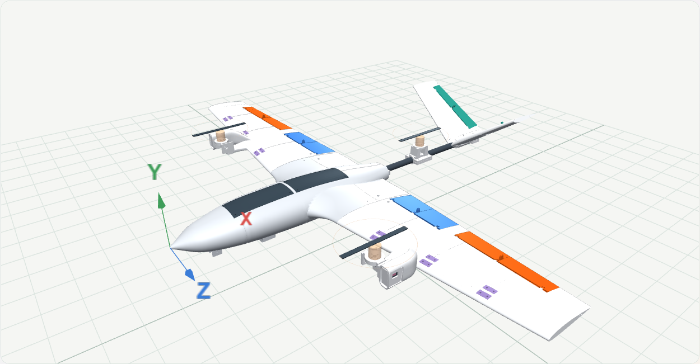
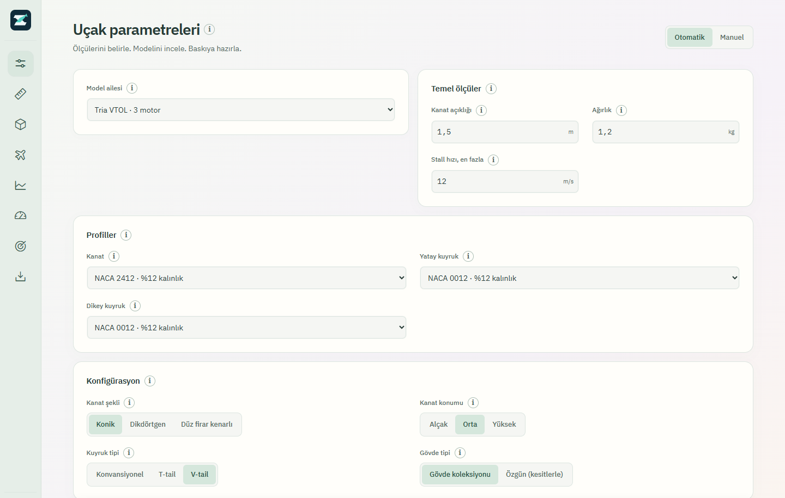
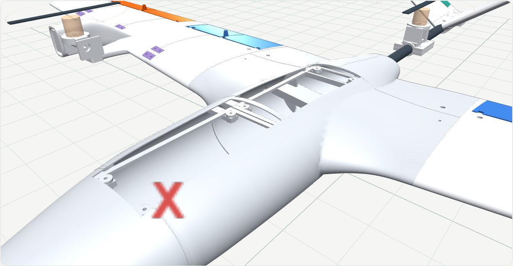

<p align="center">
  
</p>
<h1 align="center">ZETA</h1>
<p align="center"><strong>Uçağını tasarla. Montajını incele. Baskı parçalarını hazırla.</strong></p>
<p align="center">Parametrik uçak ve VTOL tasarım stüdyosu · Güncel sürüm: <strong>3.5.37</strong></p>
<p align="center">
  <a href="https://github.com/emirkalfa/zeta/releases/latest">Uygulamayı indir</a> ·
  <a href="CHANGELOG.md">Sürüm notları</a> ·
  <a href="static/references.html">Hesap yöntemleri ve kaynaklar</a>
</p>



ZETA; kanat açıklığı, toplam ağırlık, profil ve donanım ölçülerinden bir uçak modeli oluşturur. Gövde, kanat, kuyruk ve bağlantı parçalarını birlikte inceleyebilir; tasarımını proje dosyası olarak saklayabilir ve yazıcına göre bölünmüş STL paketini indirebilirsin.

Türkçe arayüz bilgisayarında çalışır. Tasarım sırasında internet bağlantısı gerekmez. Detaylı 3D önizleme, STL üretiminde kullanılan geometriyi gösterir; vida delikleri, yuvalar ve ayrı kumanda yüzeyleri bu modele dahildir.

## Başlamak için

1. [Sürümler sayfasından](https://github.com/emirkalfa/zeta/releases/latest) uygulama paketini indir ve aç. Hazır Windows paketi için Python kurulumu gerekmez.
2. Kanat açıklığını, pil dahil toplam ağırlığı ve profili gir. Normal gövde, Tria VTOL veya Penta VTOL ailesini seç.
3. **Hesapla** ile ölçüleri oluştur. **3D model** ekranında detaylı üretim önizlemesini, bağlantıları ve hareketli yüzeyleri incele.
4. Projeni kaydet. **STL indirme** ekranında yazıcı ölçülerini ve geçme boşluğunu girerek montaj paketini oluştur.



## Model aileleri

| Aile | Modelin yapısı |
|---|---|
| **Atlas** | Geniş ekipman hacimli, ölçüleri düzenlenebilen gövde. |
| **Seyir** | Alternatif gövde kesitleriyle parametrik sabit kanat tasarımı. |
| **Akın** | Farklı burun ve gövde kesitlerine sahip parametrik tasarım. |
| **Savaşan İHA** | Kısa merkez gövde, çift kuyruk bomu ve arka motor yerleşimi. |
| **Tria VTOL** | İki bağımsız döner ön motor, bir sabit dikey arka motor ve karbon kuyruk borusu. Sabit gövde ailesi ve orta kanat yerleşimi. |
| **Penta VTOL** | Dört dikey kaldırma motoru, bir arka itici motor ve çift bomlu kuyruk. Gövde ölçüleri kanat ve motor ölçülerine uyarlanır; üst, orta ve alt kanat konumları seçilebilir. |

Dikdörtgen, konik ve düz firar kenarlı kanat seçenekleri bulunur. Kanat kökü, motor bağlantıları ve üretim parçaları seçilen modele göre yeniden oluşturulur. Sabit gövde kısıtları ilgili model ailesinde korunur.

## Tasarımdan montaja

### Bağlantıları gerçek geometride gör

Kanat kökleri gövdedeki profil yuvalarına oturur ve metal pimle sabitlenir. İç destekler, karbon boru kanalları, motor tablaları, vida geçme delikleri ve somun cepleri üretim önizlemesinde incelenebilir. Montaj ayrıntıları listesinden ilgili bağlantıya yakınlaştırılabilir.

Tria'nın ön motor mekanizmalarında servo bölmesi ve ayrı servis kapağı bulunur. Arka motor, karbon boruya vidalı kelepçeyle bağlanır. Penta'nın kaldırma motorları alçak tablalar ve geniş geçişli taşıyıcılar üzerine oturur. Motorun gerçek montaj ölçüleri kendi alanlarından girilir.

### İki ayrı yerden servis yap

Gövdenin üstünde, aralarında sabit köprü bulunan iki bağımsız servis kapağı vardır. Her kapak dört vida ve alt oturma çerçevesiyle kendi açıklığına oturur. **Servis kapakları** bölümünden ön ve arka kapak ayrı gizlenerek iç bölmeler incelenebilir. Kapaklar STL paketinde ayrı parçalar olarak bulunur.



### Kumanda yüzeylerini ayrı üret

Flap, aileron, elevator, rudder ve V-kuyruk kumanda yüzeyleri ayrı STL parçalarıdır. Metal pim kanalları ve bağlantı kolları modele dahildir. Geniş tabanlı, yuvarlatılmış kumanda kollarında iki bağlantı deliği bulunur; gerçek servo kolu ve itme çubuğuna göre uygun delik seçilebilir. Hareket önizlemesi, parçayı kendi menteşe ekseni çevresinde döndürür.

### İniş takımını dışarıdan bağla

Normal gövdelerde bir ön ve iki ana teker bağlantı yuvası bulunur. VTOL gövdelerinde iki ön ve bir arka merkez bağlantı yuvası vardır. M3 vida delikleri ve içeriden erişilen somun cepleri gövdeye dahildir. Tekerler, ayaklar ve harici taşıyıcılar basılı modelin parçası değildir.

Simülasyon için **Tek STL (mm)** seçeneği, montaj konumlarını koruyan birleşik dış yüzeyi tek dosyada verir. Yazıcıya göre bölünmüş parçalar ve montaj donanımı için ZIP seçeneğini kullanın.

## STL paketinde neler var?

- Yazıcı hacmine göre bölünmüş gövde, kanat ve kuyruk parçaları.
- İki servis kapağı ve tasarımın gerektirdiği motor/servo taşıyıcıları.
- Ayrı kumanda yüzeyleri, menteşe geometrileri ve kontrol kolları.
- Vidalı kanat dilim modunda bütünleşik iç dil ve yuvalar; ayrı köprü gerektirmeyen vida kilitleri.
- Geçme ve menteşe deneme parçaları.
- Parça bilgileri için `manifest.json`, montaj sırası için `MONTAJ.txt`.

Geometri veya montaj boşluğu uygun değilse uygulama ilgili parçayı ve değiştirilecek ayarı açıklar. Yazıcı hacmini gerçek ölçülerinden büyük girerek kontrolü atlamayın. Kanat dilimleri seçilen montaj yöntemine göre vidalı iç geçmelerle veya yapıştırılarak birleştirilir; diğer dilimlerin yöntemi montaj dosyasında belirtilir.

Motor, pervane, servo, metal pim, vida, somun, karbon boru ve iniş takımı donanımı ayrıca temin edilir.

## Projelerini sakla

Parametrelerini proje dosyası olarak bilgisayarına kaydedebilir ve daha sonra uygulamada yeniden açabilirsin. Kayıtlı tasarımı değiştirdikten sonra modeli ve üretim paketini yeniden hesaplayabilirsin. Uygulama verileri kullanıcı veri dizininde tutulur; kaynak kod deposuna eklenmez.

## Hesapların kapsamı

ZETA; kanat alanı, tahmini stall hızı, kuyruk hacmi, kararlılık ön değerlendirmesi, performans ve görev hesapları sunar. Otomatik kanat boyutlandırması girilen ağırlığı ve hedef stall hızını dikkate alır. Kuyruk hesaplarında ilgili yüzeylerin aerodinamik merkezleri arasındaki mesafe kullanılır; V-kuyruğun yatay ve dikey etkin alanları ayrı değerlendirilir.

Bu sonuçlar bir ön tasarım aracıdır. Gerçek ağırlık merkezi, profil davranışı, tahrik verisi, servo hareketi ve basılı parçaların dayanımı ölçülmelidir. Geometrik çakışma ve kapalı STL kontrolleri, fiziksel yük testi veya uçuşa elverişlilik onayı yerine geçmez. VTOL dikey kalkışı ve geçiş uçuşu simülasyonla doğrulanmış değildir.

Yöntemler: [uygulama kaynakları](static/references.html), [hesap denetimi](docs/AUDIT-2026-10-08.md), [boyutlandırma incelemesi](docs/SIZING-AUDIT-2026-10-11.md), [karşılaştırma verileri](tests/reference_data/README.md).

## İndirme ve çalıştırma

| Platform | İndirme |
|---|---|
| **Windows 10/11, x64** | [ZETA 3.5.29 uygulaması](https://github.com/emirkalfa/zeta/releases/download/v3.5.29/ZETA-3.5.29-windows-x64.exe) |
| **Linux / macOS** | [Sürümler sayfasındaki platform paketleri](https://github.com/emirkalfa/zeta/releases) |

Bu depo gizlidir. Kaynak koda ve indirme dosyalarına erişmek için yetkili GitHub hesabıyla giriş yapılmalıdır. Hazır uygulama yerine GitHub'ın otomatik `Source code` arşivini indirmeyin. Dosyanın bütünlüğünü sürümdeki `SHA256SUMS.txt` ile kontrol edebilirsiniz.

Windows'ta Chrome veya Edge varsa uygulama ayrı pencerede açılır; diğer durumda varsayılan tarayıcı kullanılır. Masaüstünde yalnız kısayol bulundurabilirsiniz. İmzalanmamış paketler için işletim sistemi uyarı gösterebilir; yalnız güvendiğiniz sürüm dosyasını çalıştırın.

## Kaynak kodla çalışmak

Python 3.10+ kullanın. Geometri testleri için Node.js gerekir.

```bash
python -m pip install -e ".[dev]"
python app.py
```

Windows için `start.bat`, Linux/macOS için `start.sh` başlatıcıları da bulunur.

```bash
python -m pytest
node --test tests/*.cjs
python scripts/smoke_test.py
```

Masaüstü paketi üretmek için:

```bash
python -m pip install -e ".[build]"
python packaging/build.py
```

Paketler `dist/release/` klasörüne yazılır. Paketleyici çalıştığı işletim sistemi için çıktı üretir. GitHub Actions testleri ve platform paketlemelerini yürütür; sürüm akışı ayrıntıları [yayınlama rehberinde](RELEASING.md) bulunur.

| Bölüm | Konum |
|---|---|
| Uygulama ve API | `app.py` |
| Hesaplar ve üretim geometrisi | `backend/` |
| Arayüz ve 3D önizleme | `templates/`, `static/` |
| Masaüstü paketleme | `packaging/` |
| Doğrulamalar | `tests/` |

[Sürüm geçmişi](CHANGELOG.md) · [MIT lisansı](LICENSE)
