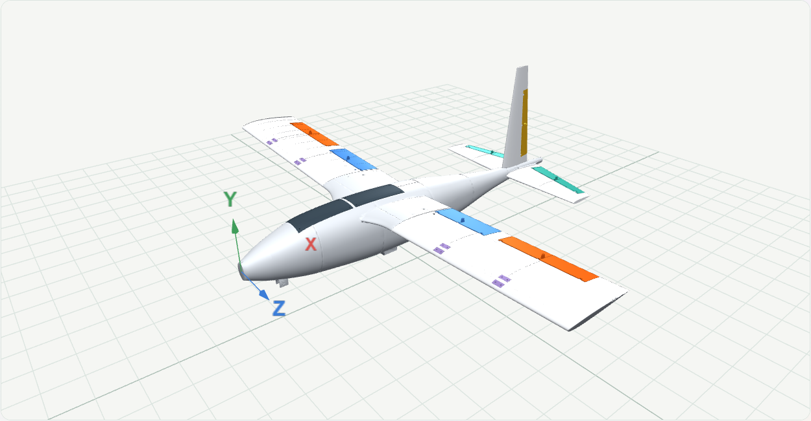
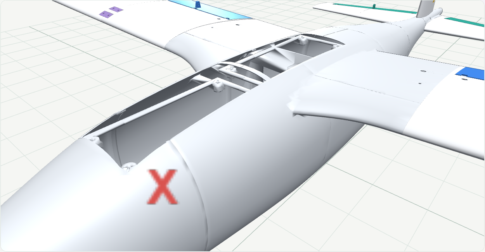

<p align="center">
  
</p>
<h1 align="center">ZETA 3.5.29</h1>
<p align="center"><strong>Sabit kanatlı uçaklar için parametrik tasarım, aerodinamik ön değerlendirme ve parçalı STL üretimi.</strong></p>
<p align="center">
  <a href="https://github.com/emirkalfa/zeta/releases/latest">En son sürümü indir</a> ·
  <a href="CHANGELOG.md">Sürüm notları</a> ·
  <a href="docs/AUDIT-2026-10-08.md">Hesap denetimi</a>
</p>



ZETA; kanat açıklığı, toplam ağırlık, profil, gövde, kuyruk ve motor ölçülerinden düzenlenebilir bir uçak modeli oluşturur. Montaj parçalarını 3D görünümde inceleyebilir, aerodinamik eğrileri karşılaştırabilir ve yazıcınızın hacmine göre bölünmüş STL dosyalarını ZIP halinde indirebilirsiniz. Arayüz Türkçedir ve internet olmadan çalışır.

## 3.5.29 ile güncel durum

- **Altı gövde ailesi:** Atlas, Seyir, Akın, Savaşan İHA, üç motorlu Tria VTOL ve beş motorlu Penta VTOL.
- **Tria:** iki döner ön motor, entegre servo bölmeleri, karbon kuyruk borusu yuvaları ve vidalı arka motor kelepçesi. Gövde ailesi sabittir.
- **Penta:** kanat ve motor ölçülerine göre boyutlanan kısa gövde; üst, orta ve alt kanat konumları; alçak motor tablaları ve geniş geçişli taşıyıcılar. Dört dikey kaldırma motoru ve bir arka itici motor.
- **İki bağımsız servis kapağı:** sabit orta köprü, her kapakta dört vida ve alt oturma çerçevesi. Önizlemede ayrı gizlenebilir; STL paketinde ayrı parçalar olarak bulunur.
- **Kumanda kolları:** flap, aileron, elevator, rudder ve V-kuyruklarda geniş destekli, yuvarlatılmış, iki delikli kollar.
- **Harici iniş takımı montajı:** normal gövdelerde bir ön ve iki ana teker yuvası; VTOL gövdelerinde iki ön ve bir arka merkez bağlantı yuvası. M3 delikleri ve içeriden erişilen somun cepleri gövdeye dahildir. Ayak ve teker geometrisi üretilmez.
- **Kaydedilen projeler:** proje dosyasını bilgisayara kaydetme ve uygulamada yeniden açma; yazıcı hacmine göre parçalı STL ZIP ve montaj bilgileri.



Bu modeller mekanik ve aerodinamik ön tasarımdır. Gerçek ağırlık merkezi, itki, servo hareketi, iniş yükü ve basılı bağlantı dayanımı fiziksel doğrulama gerektirir. Ayrıntılı değişiklikler [sürüm notlarında](CHANGELOG.md).

## 3.5.12 boyutlandırma düzeltmesi

Otomatik kanat boyutu, toplam ağırlık ve ilk menüdeki hedef stall hızına göre gerektiğinde büyür; açıklık ve mevcut planform alt sınırı korunur. Kuyruk hacmi hesabı ve kararlılık raporu aynı aerodinamik merkez mesafelerini kullanır. Manuel ölçüler, sabit Tria gövdesi ve montaj özellikleri korunur. Profil CLmax tahmini ve başlangıç kuyruk hacim hedefleri uçuş testiyle doğrulanmış değerler değildir. [Yöntem ve kaynaklar](static/references.html).

## İndir ve çalıştır

**Python kurmanız gerekmez.** [GitHub Releases](https://github.com/emirkalfa/zeta/releases/latest) sayfasında **Assets** bölümünü açın ve işletim sisteminize uygun uygulama dosyasını indirin. GitHub'ın otomatik eklediği `Source code` arşivleri hazır uygulama değildir.

| Sistem | Paket | Durum |
|---|---|---|
| Windows 10/11, x64 | [ZETA-3.5.29-windows-x64.exe](https://github.com/emirkalfa/zeta/releases/download/v3.5.29/ZETA-3.5.29-windows-x64.exe) | Güncel sürüm |
| Linux, x86_64 | [Önceki AppImage paketleri](https://github.com/emirkalfa/zeta/releases) | Yeni paket yayınlanana kadar önceki sürümler |
| macOS, Apple Silicon | [Önceki macOS paketleri](https://github.com/emirkalfa/zeta/releases) | Yeni paket yayınlanana kadar önceki sürümler |

Depo ve sürüm dosyaları gizlidir; indirmek için yetkili GitHub hesabıyla giriş yapın. Windows paketinin SHA-256 özetini sürümdeki `SHA256SUMS.txt` ile karşılaştırabilirsiniz.

Windows'ta Chrome/Edge varsa ayrı uygulama penceresi açılır; diğer durumlarda varsayılan tarayıcı kullanılır. Pencere/sekme kapatılınca ZETA sunucusu da kapanır. Aynı porttaki açık kopya tekrar kullanılabilir. İşlem ve dosyalar bilgisayarınızda kalır.

Paketler imzasızdır. Windows'ta dosyanın bu depodan geldiğini doğruladıktan sonra **Ek bilgi → Yine de çalıştır**, macOS'ta sağ tık **Aç** gerekebilir. Linux'ta FUSE yoksa `./ZETA-3.1.0-linux-x86_64.AppImage --appimage-extract-and-run` kullanılabilir. İndirilen dosyayı sürümdeki `SHA256SUMS.txt` ile doğrulayabilirsiniz.

Masaüstünde yalnızca bir simge istiyorsanız uygulamayı ayrı bir klasöre koyup masaüstüne kısayol oluşturun. Paketli uygulamanın veritabanı kullanıcı veri dizininde, form tercihleri tarayıcının yerel deposunda saklanır.

## 3.1.0 ile gelenler

- **Yeni stüdyo arayüzü:** açık/koyu tema, mobil düzen, katlanabilir gelişmiş ayarlar ve özgün ZETA logosu.
- **Yerinde açıklamalar:** parametrelerin yanındaki küçük **ⓘ** düğmeleri ne işe yaradıklarını, birimlerini, varsayımlarını ve NASA/MIT/UIUC kaynaklarını açar.
- **Dört gövde:** Atlas, Seyir, Akın ve çift bomlu Savaşan İHA. Boyutları değiştirebilir veya kesitlerle özgün gövde hazırlayabilirsiniz.
- **Üretimle eşleşen önizleme:** gövde kapağı, kanat/kuyruk bağlantıları ve motor taşıyıcıları gerçek STL geometrisiyle gösterilir.
- **Ölçüye göre motor montajı:** tek gövde motoru veya çift kanat motoru; çap, vida düzeni, delik aralığı, mil ve kablo boşlukları. Kanat değişirken motorun gerçek ölçüleri sabit kalır.
- **Yazıcıya göre parçalı ZIP:** model büyüdükçe gerekli parça sayısı artar. ZIP; ayrı STL'ler, montaj bilgileri ve geçme deneme parçalarını içerir.
- **Ayrı hareketli kontrol yüzeyleri:** flap, aileron, elevator ve rudder/ruddervator ayrı STL olarak alınabilir. 3D görünümde pim ekseni çevresinde hareketi incelenebilir; menteşe/pim kuponları ZIP'e dahildir.
- **Kanat kökü kaplamaları:** kavisli gövde ile düz kanat kökü arasındaki boşluğu örten, montaja göre yeniden oluşan içi boş parçalar tüm montaj ZIP'inde ayrı STL'dir.
- **Hareket boşluğu denetimi:** kontrol yüzeylerinin ±25° hareketi gövdeye ve diğer basılı parçalara çarpma yönünden temsilî testlerle kontrol edilir.
- **Hesap düzeltmeleri:** gerçek kuyruk kolu, güç dengesiyle azami hız, aviyonik tüketimini içeren menzil hesabı ve açık girdi doğrulaması.


## İlk tasarımın

1. **Parametreler:** kanat açıklığı ve pil dahil toplam ağırlığı gir. Profil, kanat ve kuyruk tipini seç. Gelişmiş bölümlerde motor ve görev bilgilerini düzenle.
2. **Hesapla:** diğer ekranlar açılır. Bir alanı bilmiyorsan yanındaki **ⓘ** açıklamasını oku; başlangıç değerleri kendi donanımının ölçümü değildir.
3. **Gövde ve 3D model:** gövdeyi seç, ölçülerini düzenle ve montajı incele. Motor servis kapaklarını gizleyerek iç bağlantıları görebilirsin.
4. **Analiz / Ön değerlendirme / Görev:** grafiklerin kapsamını ve varsayımlarını incele. Kütle, güç ve verim değiştikçe sonuçları karşılaştır.
5. **STL indirme:** kullanılabilir yazıcı hacmini, et kalınlığını ve geçme boşluğunu gir. İlgili parçaları veya bütün montajı ZIP olarak indir; dilimleyicide baskı yönü ve destekleri kontrol et.

### Model ve montaj ayrıntıları

Çalışma sürümünde her kanat yarısı, kanat profili biçimindeki gövde yuvasına oturur ve tek metal pimle tutulur. STL ayarlarındaki **Kanat sabitleme pimi çapı** (varsayılan 3 mm) ve **Kanat kökü oturma derinliği** (varsayılan 8 mm, 4–12 mm) ile bağlantı yeniden oluşturulur. Yuva ve pim deliği gerçek üretim önizlemesinde ve gövde/kanat STL parçalarında bulunur. Başlı, emniyet klipsli pim ayrıca alınır; kök geçmesini önce deneme baskısıyla kontrol edin. Karbon boru kanalları iç takviye için korunur.

Üç kanat planformu, üç yükseklik konumu ve klasik/T/V kuyruk düzenleri bulunur. Çift bomlu gövdede kuyruk yerleşimleri gövdeye uygun biçimde oluşturulur. Kanat yüksekliği değişince gövde yuvaları, kanat motorları ve çift bomlu kuyruk birlikte güncellenir.

Gövde kapağı ayrı parçadır. Kanat/kuyruk geçmeleri ve vida/somun yuvaları ZIP'e yansır. Kanat motorlarının ayrı alt servis kapakları içeriden vidalamaya erişim sağlar. Savaşan İHA'nın tek arka motorunda montaj yüzeyi girilen motor çapına uyarlanır. Delikler bu çapa sığmıyorsa ölçü hatası gösterilir. Flap, aileron, elevator ve rudder/ruddervator parçaları ayrı basılır ve modeldeki pimli menteşeleri kullanır; metal pim, servo ve itme çubukları donanım olarak ayrıca alınır, servo modeline özel yatak değildir.

Motorlar, pervaneler, vidalar ve karbon borular satın alınan donanımdır; önizlemedeki motor/pervane referansları basılacak parça değildir. Hareket yüzeyi bağlantı ve hareketi, servo/itme çubuğu kurulumu ve baskı dayanımı gerçek donanımla ayrıca denenmelidir. Büyük modeldeki ek kesimler düz yapıştırma yüzeyleri olabilir; ZIP'in montaj notlarını okuyun.

## Hesaplar ne kadar doğrulanmış?

**Sonuçlar teorik ön değerlendirmedir; uçuşa uygunluk onayı değildir.** NASA ve MIT kaynakları temel denklemleri destekler. Yedi NACA profilinin geometrisi yayınlanmış UIUC koordinatlarıyla karşılaştırılmıştır. Geometrinin doğru olması, aerodinamik katsayıların deneysel olarak doğrulandığı anlamına gelmez.

- Grafikler kanat içindir; gövde şekline özel CFD veya ölçülmüş sürükleme modeli bulunmaz.
- Profil CD0, CLmax ve stall sonrası davranış yaklaşık modellerdir. Düşük Reynolds koşullarında ölçülmüş polarlarla kalibrasyon gerekir.
- Görev hesabında sabit hava yoğunluğu, girilen toplam tahrik verimi ve genel ek sürükleme payı kullanılır.
- Gerçek CG, yapısal dayanım, trim, dinamik/yönelme kararlılığı, kumanda sistemi ve tahrik performansı ayrıca doğrulanmalıdır.

[Denetim raporu](docs/AUDIT-2026-10-08.md), [3.1.0 doğrulama raporu](docs/VALIDATION-3.1.0.md), [uygulama içindeki yöntem ve kaynaklar](static/references.html) ve [karşılaştırma verileri](tests/reference_data/README.md) ayrıntıları açıklar. 3.1.0 sürümünde bu çalışma alanında 100 Python testi ve 29 JavaScript testi geçti; Windows paketinden 36 gerçek baskı parçası üretildi ve kapalı STL/yazıcı hacmi kontrolleri doğrulandı. Testler temsilî senaryoları kapsar.

## Kaynak koddan çalıştırma

Python 3.10+ gerekir. Depoyu indirip Windows'ta `start.bat`, Linux/macOS'ta `./start.sh` çalıştırın; betik bağımlılıkları kurar. Elle kurulum:

```sh
git clone https://github.com/emirkalfa/zeta.git
cd zeta
pip install -r requirements.txt
python app.py
```

Adres: `http://127.0.0.1:5000`. Port doluysa sonraki boş port seçilir. `--port 5082`, `--no-browser` ve `--desktop` seçenekleri desteklenir. Kaynak kodda değişiklikleri izlemek için `FLASK_DEBUG=1` kullanın (PowerShell: `$env:FLASK_DEBUG='1'`).

## Geliştirme ve paketleme

```sh
pip install -e ".[dev]"
python -m pytest
node --test tests/*.cjs
python scripts/smoke_test.py

pip install -e ".[build]"
python packaging/build.py
```

Geometri testlerinde Node.js de gerekir. İsteğe bağlı çevrimdışı tarayıcı testi için `pip install -e ".[ui-test]"` ve `python scripts/check_studio_ui.py` kullanılır; bu betik Windows'ta kurulu Chrome/Edge'i izole profille açar.

Paketler `dist/release/` altında oluşur. Yerel paketleyici yalnız çalıştığı işletim sistemi için çıktı üretir. GitHub Actions, `v*` etiketi gönderildiğinde üç platformda test ve paketleme yapar; paketleri ve SHA256 özetlerini Release'e yükler. [Yayınlama adımları](RELEASING.md).

| Bileşen | Konum |
|---|---|
| Sunucu, API, masaüstü başlatıcı | `app.py` |
| Geometri, analiz, kararlılık, görev | `backend/` |
| Gerçek montaj ve parçalı STL üretimi | `backend/manufacturing.py` |
| Arayüz ve 3D görünüm | `templates/`, `static/` |
| Paketleyici | `packaging/` |
| Testler ve karşılaştırma koordinatları | `tests/` |

Sürüm geçmişi: [CHANGELOG.md](CHANGELOG.md). Lisans: [MIT](LICENSE).


### Kanat dilimlerinin vidalı montajı (3.2.3)

Arayüzde varsayılan **Geçmeli ve vidalı** modda sabit kanatlar yazıcı hacmine göre dilimlenir. Her birleşimde toplam dört vida
ve bu vidaları taşıyan iki dar veya tek geniş geçmeli köprü oluşturulur.
`wing_*_join_*_bridge_*.stl` dosyaları köprülerdir; ZIP içindeki `MONTAJ.txt`
hangi köprünün hangi iki kanat dilimine oturacağını belirtir.

1. Önce mevcut geçme deneme parçalarını basıp boşluk ayarını kontrol edin.
2. Kanat dilimlerini boru kanalları hizalanacak şekilde yerleştirin.
3. Mor gösterilen köprüleri üst yüzeydeki eşleşen yuvalarına oturtun.
4. Alt yüzden altıgen somunları yuvalarına yerleştirip tutun; vidaları üstten
   takın. Önce hepsini gevşek yerleştirin, hizaladıktan sonra sıkın.
5. Vida boyunu gerçek basılı parça ve donanımla kontrol edin. Vidalar, somunlar
   ve karbon borular satın alınır; STL'de basılan parçalar değildir.

Kanadın gövdeye bağlantısı mevcut profil yuvası ve tek emniyetli metal pimle
kalır. Flap/aileron, kuyruk ve diğer parçaların mevcut dilim montaj yöntemi
korunur. Bağlantı için yeterli et kalınlığı veya erişim yoksa eksik bağlantılı
ZIP verilmez; uygulama ilgili ayarlara yönlendiren bir açıklama gösterir.
3D önizleme ve ZIP aynı üretim geometrisini kullanır. Geometrik testler gerçek
baskının dayanım, titreşim ve uçuşa elverişlilik testlerinin yerine geçmez.

Önceki yapıştırmalı yöntem, STL ayarlarındaki **Kanat dilim bağlantısı** alanından ayrıca seçilebilir. Eski API istemcilerinde `wingJoinMode` gönderilmezse önceki yöntem korunur; yeni arayüz `bolted` değerini açıkça gönderir. Vidalı üretimde yer bulunamazsa otomatik olarak yapıştırmalı yönteme geçilmez.

### Tria VTOL mekanik prototipi (3.5.0)

3.5.1'de ana gövde sabit bir profile alındı: 672 mm ana gövde uzunluğu, 170 mm azami en, 110 mm azami yükseklik. Oran, özgün kesit ve kanat yüksekliği ayarları Tria'da kapalıdır. Kanat yuvası sabit orta konumda oluşturulur. Sunucu kayıtlı eski kesitleri ve oranları kullanmak yerine sabit gövdeyi üretir; üretim önizlemesi ile STL aynı yüzeyi kullanır. Kanat kökü yükseltmesi gövde tavanına göre sınırlanır. Donanım ve kanat ölçüleri kendi alanlarında ayarlanabilir.

Parametreler ekranında Model ailesi alanından Tria VTOL seçilir. Ayrı bölümde motor, pervane, pivot ve servo ölçüleri girilir. Ön iki motor bağımsız döner, arka motor sabit dikeydir. Önizlemede 0 derece dikey, 90 derece ileri, -20 derece geri yatış referansıdır. Gerçek STL taşıyıcıları pivot, motor ve bağlantı deliklerini içerir. Motor, servo, metal miller ve pervaneler satın alınır; STL olarak üretilmez.

Ön mekanizma 3.4.1'de kompakt yan servo düzenine dönüştürüldü. Varsayılan pivot yüksekliği 25 mm'dir. Servo, yandaki servis bölmesine oturur; motor taşıyıcısına metal servo koluyla doğrudan bağlanır. Servo önünden mil merkezine mesafe ve dört kol deliğinin yarıçapı ayarlanır. Basılı servo dişi/spline yoktur. Her tarafta ayrı dört vidalı servis kapağı, kablo çıkışı, destekli pivot ve dört M3 kanat bağlantısı bulunur. Kapakları 3D'deki servis kapakları seçeneğinden gizleyerek servo ölçü referansını görebilirsiniz. STL ZIP üstünde parçalar ayrı verilir. Gerçek servo torku, kol uyumu, metal mil ve kablo payı fiziksel olarak doğrulanmalıdır. Eski 60 mm varsayılan pivot yüksekliği açılışta 25 mm'ye taşınır; diğer özel değerler korunur.

Ön motorların varsayılan kanat önü uzaklığı 75 mm'dir. 3.5.0'da servo bölmesi kanattan çıkan içi boş kaportayla çevrilir, yan servis kapağı korunur. Arka motor 35 mm yüksekliğinde taşıyıcı üzerindedir. Üst eyer ve alt kelepçe ayrı STL parçalarıdır; karbon boruyu sarar, iki geçmeyle hizalanır ve dört M3 vida/somunla birleşir. Somunlar alt ceplerden, motor vidaları taşıyıcının yan açıklıklarından takılır. Eski projenin 150 mm varsayılan ön mesafesi ilk açılışta 75 mm'ye güncellenir; diğer özel değerler korunur.

Gövde ile kuyruk arasındaki karbon boru satın alınır; STL'ye eklenmez. Dış/iç çapı ve gövde içine sokulacak uzunluk VTOL bölümünde girilir. Gövdede kör yuva, takviye bölmesi ve iki vidalı sıkma kulakları; kuyrukta ayrı boru taşıyıcısı ve iki vidalı sıkma kulakları basılır. Kuyruk kökleri bu ayrı taşıyıcıya geçip vidalanır. Kelepçe vidaları karbon boruyu delmeden dış kulakları sıkar. Borunun gereken kesim uzunluğu ZIP manifestinde bulunur; basılı parçaların kayması/dönmesi, karbonun ezilmesi ve yük dayanımı gerçek donanımla denenmelidir.

Motor üçgeni ve denge bölümünde geometrik merkez, sabit kanat CG ayarından türetilen varsayılan CG ve dikey motorların statik itki payları gösterilir. İtki yüzdeleri gaz komutu değildir. Gerçek ağırlık merkezi pil, donanım ve baskı yerleşimine göre ölçülmelidir; motor gücü ve kontrolcü kapasitesi bu hesapla doğrulanmaz.

3.3.2 ile gövdeye ait içi boş merkez kanat geçişi genişletildi ve dışarı doğru yumuşak daralır. Sökülebilir kanat kökü bu geçişin ucundaki profil yuvasına oturur; tek pim ve boru kanalları korunur. Üretim önizlemesi STL ile aynı geçiş yüzeylerini gösterir. Bu şeklin aerodinamik iyileşmesi CFD veya rüzgâr tüneliyle ölçülmüş değildir.

### Penta VTOL mekanik prototipi (3.4.0)

Model ailesinden Penta VTOL seçildiğinde dört sabit dikey kaldırma motoru ve bir arka itici motor oluşturulur. Çift bom ve ikiz finli yatay kuyruk hazır gelir. Kaldırma motoru ölçüleri özel VTOL bölümünde, beşinci itici motorun ölçüleri ayrı BLDC bölümünde girilir. Kaldırma yüksekliği ve pervanelerin kanat önü/arkasındaki boşluğu ayarlanabilir. Bu modelin motorları yön değiştirmez; Tria'nın iki bağımsız döner motoru kendi seçeneğinde korunur.

İki içi boş kaldırma rayı kanat profiline toleranslı oturma yüzeyleriyle oturur; her ray dört M3 vida ve altıgen somun cebi içerir. Motor vidalarına açık taşıyıcıların yanlarından erişilir, mil/kablo geçişleri tablada bulunur. Gerçek üretim önizlemesi bütün bağlantı deliklerini ve ayrı STL ray parçalarını gösterir. Yazıcıya göre bölünen ray dilimleri hizalanıp yapıştırılır; yük ve titreşim testi gereklidir. Motorlar, pervaneler ve metal bağlantılar satın alınır. Uygulama katı parçalar ve pervane diskleri arasında geometrik çakışma kontrolü yapar; fiziksel dayanım, itki dengesi, ağırlık merkezi, hover ve geçiş uçuşu doğrulanmış değildir.

Otomatik modda vidalı kanat dilimlemesi bir bağlantı yeri uygun değilse alternatif kesim düzlemlerini ve ek dilimleri dener. Dört vida, delik erişimi, hareketli yüzeyler, boru kanalları ve gerçek yazıcı hacmi kontrolleri korunur. 2 m / 4 kg / NACA 4412 / düz arka kenarlı Penta ve 220 × 220 × 250 mm yazıcı regresyonuyla doğrulanır. Fiziksel olarak uygun plan bulunamazsa eksik bağlantılı STL üretmek yerine açıklayıcı hata döner.

Proje kayıtları VTOL ölçülerini içerir. ZIP montaj notlarında bağlantı açıklamaları bulunur. Geometrik hareket kontrolleri -20 ile 90 derece arasında 5 derece aralıklarla örneklenir. Fiziksel baskı, yük, servo torku, kablo/itme çubuğu hareketi, hover, yön kontrolü ve geçiş uçuşu testleri yapılmamıştır. Mevcut grafikler yalnızca sabit kanat ön hesabıdır. Mekanizma yaklaşımı için [ArduPilot Tilt Rotor açıklaması](https://ardupilot.org/plane/docs/guide-tilt-rotor.html).

3.5.2: Wide cambered Tria center-wing transitions now overlap with real material instead of meeting at a non-manifold edge. The last two validated designs are retained in process memory, so repeated previews and complete ZIP exports reuse identical print parts. Changing parameters triggers a new calculation. The first detailed preview still depends on geometry complexity. Tilt collision checks retain the full angle range while checking a bounded local region.

3.5.10: Tria ön motor plakası 10 mm, kanattaki vida yatağı 14 mm kalınlığında; yumuşak geçişli destek kökü 90 mm genişliğinde. Dikdörtgen, daralan ve düz firar kenarlı kanatlarda aynı mekanizma kullanılır. Gövde-kanat köklerinde iki ayrı iç vidalı köprü, vida erişim delikleri ve somun cepleri STL ve detaylı önizlemede bulunur. İç yapıyı göster seçeneği köprüleri belirginleştirir; ZIP montaj kılavuzu karşılıklı parçaların dosya adlarını belirtir. Bu geometrik kontroller fiziksel yük testi yerine geçmez.

3.5.11: Gövde-kanat kökündeki fiziksel yumuşak geçiş ve çıkıntısız profil yuvası tüm gövde ailelerinde, üst/orta/alt kanat konumlarında ve üç kanat şeklinde ortak olarak üretilir. Çift motorlu kanat gondolları gerçek profile göre içi boş yumuşak omuzla birleşir; Penta raylarının kanat ayakları genişleyen yuvarlatılmış geçişlidir. Bu yüzeyler yalnız görsel gölgelendirme değildir: detaylı önizlemenin ve STL ZIP’inin aynı geometrisine dahildir.
