# ZETA

Parametrik uçak ve VTOL tasarım stüdyosu. Kanat açıklığını, ağırlığı ve donanım ölçülerini girerek modeli oluştur, montajı 3B incele ve yazıcı hacmine göre bölünmüş STL parçalarını indir.

[Yayınlanmış Windows paketleri](https://github.com/emirkalfa/zeta/releases) · [3.5.118 geliştirme sürümünün kaynak kodu](https://github.com/emirkalfa/zeta/tree/codex/fuselage-model-library)

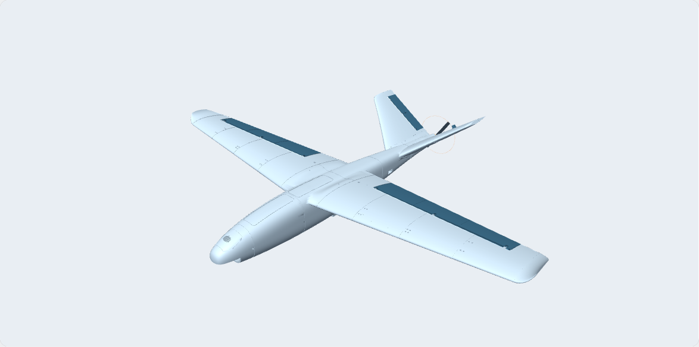

Bu sayfadaki tüm görseller **ZETA 3.5.118** 3B üretim önizlemesinden alındı.

## Burun modelleri

| Standart | Sabit kamera | Gimbal |
| --- | --- | --- |
| 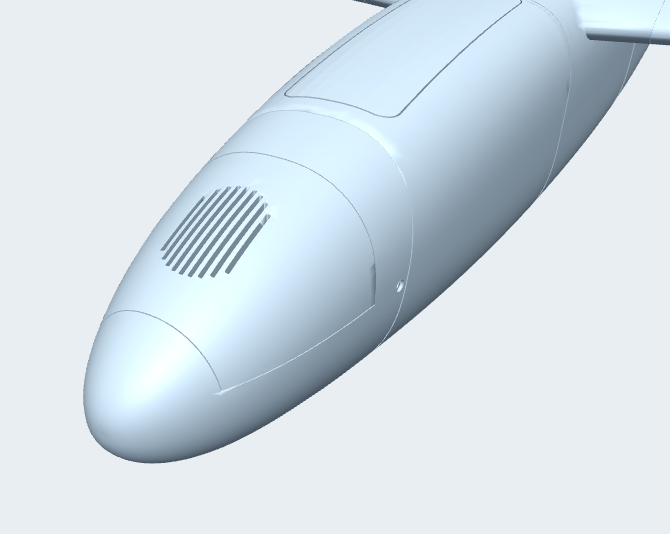 | 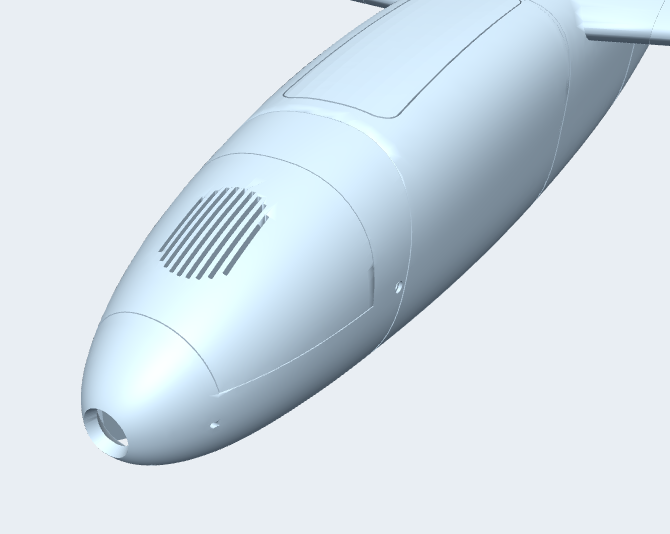 | 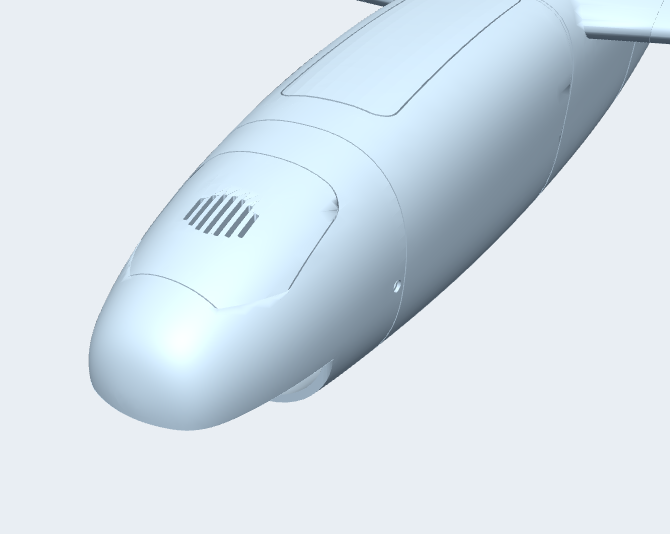 |

Goliath’ta **Gövde ayarları → Burun kamerası → Kamera yuvası** bölümünden seçim yapılır. Gimbal modelinin kısa, oval ucu gövde hattını takip eder. Kamera, alttaki kavisli açıklığın üstünde, gövdenin içindeki montaj plakasına oturur. Izgaralı kapak, plaka ve VTX tepsisi ayrı STL parçalarıdır.

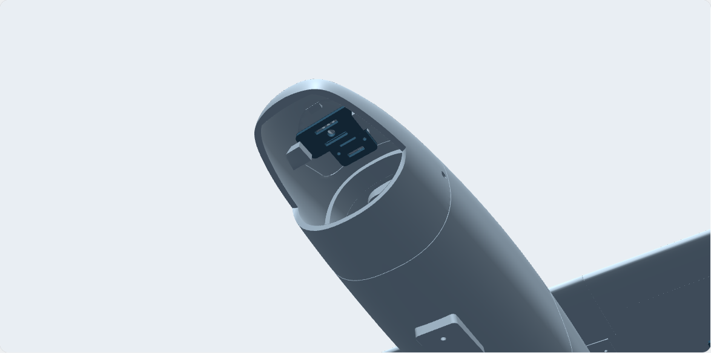

## VTOL modelleri

| Tria VTOL · 3 motor | Penta VTOL · 5 motor |
| --- | --- |
| 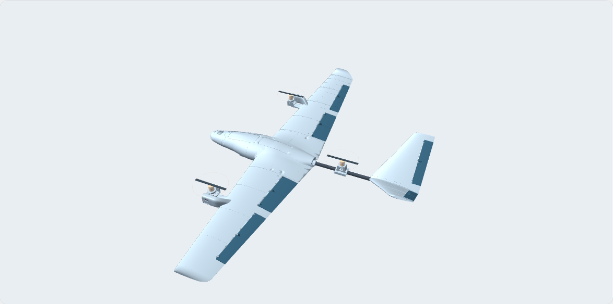 | 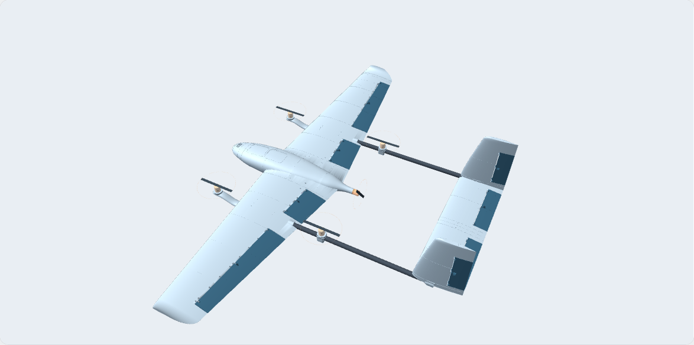 |

Sabit kanat ailesinde **Goliath**, **Caraxes**, **Lark** ve **Savaşan İHA** gövdeleri bulunur. Kanat, gövde, motor ve kuyruk ayarları ayrı bölümlerdedir.

## Kanat, kuyruk ve flap kataloğu

### Kanat tipleri

| Dikdörtgen | Konik | Düz firar kenarlı |
| --- | --- | --- |
| 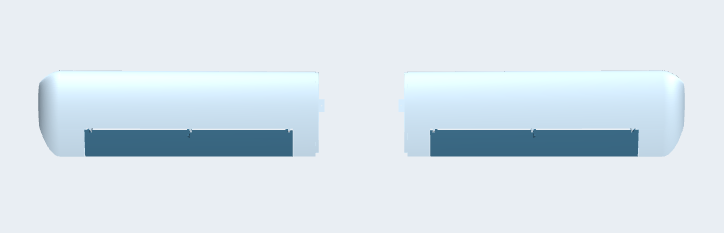 | 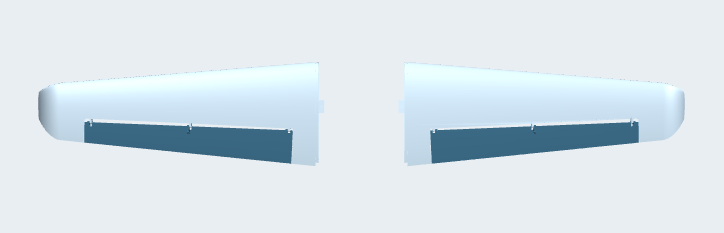 | 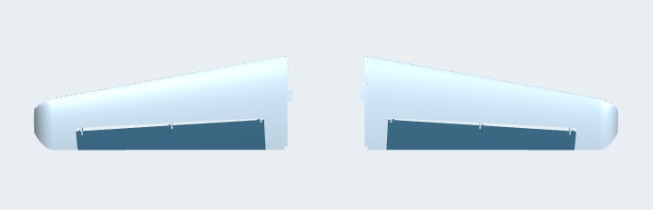 |

### Kuyruk tipleri

| Konvansiyonel | T-kuyruk | V-kuyruk |
| --- | --- | --- |
| 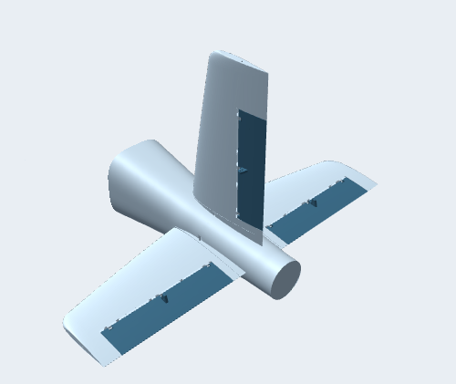 | 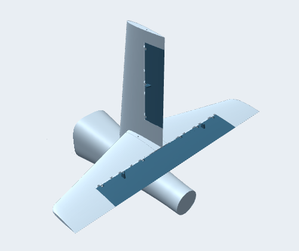 | 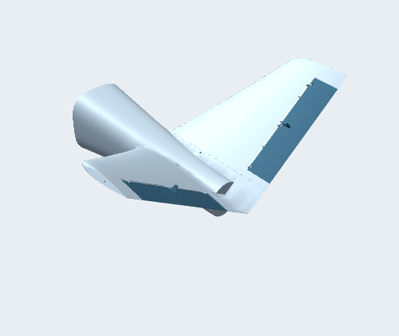 |

### Kanat kumanda yüzeyleri

| Tekli · Flaperon | Çiftli · Flap ve aileron |
| --- | --- |
| 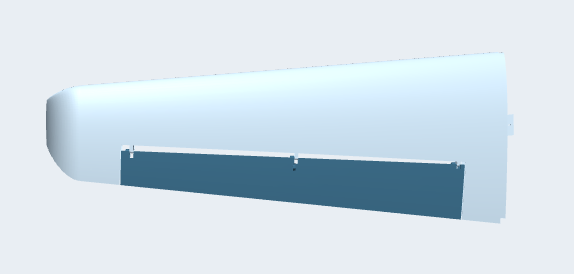 | 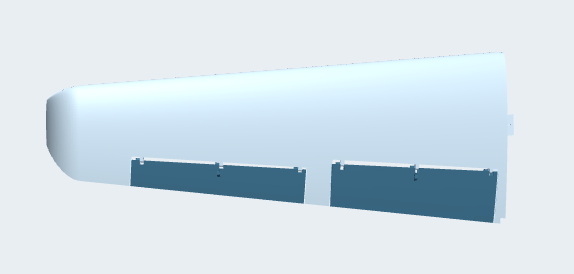 |

Tekli düzende bir yüzey flap ve aileron görevlerini birleştirir. Çiftli düzende flap gövdeye, aileron kanat ucuna daha yakındır. Hareketli yüzeyler koyu maviyle gösterilir.

## Tasarımdan STL’ye

1. **Hesapla** ile ölçülere ve seçilen profile göre modeli oluştur.
2. **3B önizleme** ekranında kanat köklerini, servo yuvalarını ve kumanda yüzeylerini incele. Montaj ayrıntıları listesinden vida veya pim bağlantısına yakınlaş.
3. Yazıcının ölçülerini ve geçme boşluğunu girip **STL paketini** oluştur. Paket, parça bilgileri ve montaj sırasını da içerir.
4. Tasarım ayarlarını proje dosyası olarak kaydet. **Simülasyon STL** seçeneği modeli Merkusim için dışa aktarır.

Hesaplar ön tasarım içindir. Uçuş öncesinde gerçek ağırlık merkezi, kumanda hareketleri ve basılı parçaların dayanımı fiziksel olarak doğrulanmalıdır.

## Kaynak kodla çalıştırma

Python 3.10 veya üstü gerekir. Arayüz testleri Node.js ile çalışır.

```bash
python -m pip install -e ".[dev]"
python app.py
```

[Hesap yöntemleri](static/references.html) · [Sürüm geçmişi](CHANGELOG.md) · [Paketleme ve yayınlama](RELEASING.md) · [MIT lisansı](LICENSE)

## Commit geçmişi

Bu çalışmada toplam **5 commit** kaydedildi. Ana dal **152**, geliştirme dalı **159** commit içeriyor. [Ana dal geçmişi](https://github.com/emirkalfa/zeta/commits/master/) · [Geliştirme dalı geçmişi](https://github.com/emirkalfa/zeta/commits/codex/fuselage-model-library/)
