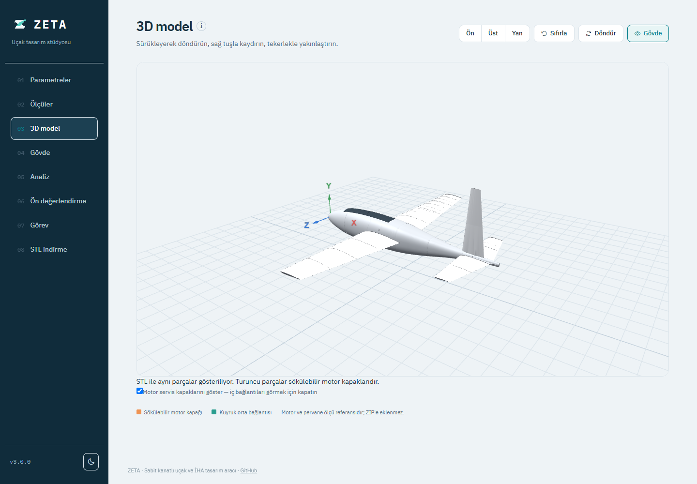
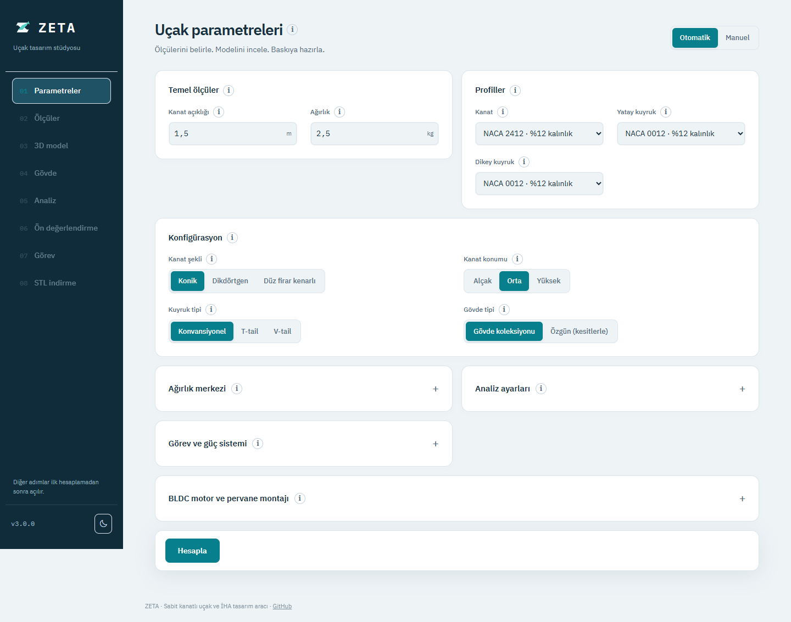

<p align="center">
  
</p>
<h1 align="center">ZETA 3.1</h1>
<p align="center"><strong>Sabit kanatlı uçaklar için parametrik tasarım, aerodinamik ön değerlendirme ve parçalı STL üretimi.</strong></p>
<p align="center">
  <a href="https://github.com/emirkalfa/zeta/releases/latest">En son sürümü indir</a> ·
  <a href="https://github.com/emirkalfa/zeta/releases/tag/v3.1.0">3.1.0 sürüm notları</a> ·
  <a href="docs/AUDIT-2026-10-08.md">Hesap denetimi</a>
</p>



ZETA; kanat açıklığı, toplam ağırlık, profil, gövde, kuyruk ve motor ölçülerinden düzenlenebilir bir uçak modeli oluşturur. Montaj parçalarını 3D görünümde inceleyebilir, aerodinamik eğrileri karşılaştırabilir ve yazıcınızın hacmine göre bölünmüş STL dosyalarını ZIP halinde indirebilirsiniz. Arayüz Türkçedir ve internet olmadan çalışır.

## İndir ve çalıştır

**Python kurmanız gerekmez.** [GitHub Releases](https://github.com/emirkalfa/zeta/releases/latest) sayfasında **Assets** bölümünü açın ve işletim sisteminize uygun uygulama dosyasını indirin. GitHub'ın otomatik eklediği `Source code` arşivleri hazır uygulama değildir.

| Sistem | 3.1.0 paketi | Açılış |
|---|---|---|
| Windows 10/11, x64 | [ZETA-3.1.0-windows-x64.exe](https://github.com/emirkalfa/zeta/releases/download/v3.1.0/ZETA-3.1.0-windows-x64.exe) | Dosyaya çift tıklayın. |
| Linux, x86_64 | [ZETA-3.1.0-linux-x86_64.AppImage](https://github.com/emirkalfa/zeta/releases/download/v3.1.0/ZETA-3.1.0-linux-x86_64.AppImage) | Çalıştırma izni verip açın. |
| macOS, Apple Silicon | [ZETA-3.1.0-macos-arm64.zip](https://github.com/emirkalfa/zeta/releases/download/v3.1.0/ZETA-3.1.0-macos-arm64.zip) | ZIP'i açıp `ZETA.app` dosyasını Uygulamalar'a taşıyın. |

Windows'ta Chrome/Edge varsa ayrı uygulama penceresi açılır; diğer durumlarda varsayılan tarayıcı kullanılır. Pencere/sekme kapatılınca ZETA sunucusu da kapanır. Aynı porttaki açık kopya tekrar kullanılabilir. İşlem ve dosyalar bilgisayarınızda kalır.

Paketler imzasızdır. Windows'ta dosyanın bu depodan geldiğini doğruladıktan sonra **Ek bilgi → Yine de çalıştır**, macOS'ta sağ tık **Aç** gerekebilir. Linux'ta FUSE yoksa `./ZETA-3.1.0-linux-x86_64.AppImage --appimage-extract-and-run` kullanılabilir. İndirilen dosyayı sürümdeki `SHA256SUMS.txt` ile doğrulayabilirsiniz.

Masaüstünde yalnızca bir simge istiyorsanız uygulamayı ayrı bir klasöre koyup masaüstüne kısayol oluşturun. Paketli uygulamanın veritabanı kullanıcı veri dizininde, form tercihleri tarayıcının yerel deposunda saklanır.

## 3.1.0 ile gelenler

- **Yeni stüdyo arayüzü:** açık/koyu tema, mobil düzen, katlanabilir gelişmiş ayarlar ve özgün ZETA logosu.
- **Yerinde açıklamalar:** parametrelerin yanındaki küçük **ⓘ** düğmeleri ne işe yaradıklarını, birimlerini, varsayımlarını ve NASA/MIT/UIUC kaynaklarını açar.
- **Dört gövde:** Atlas, Seyir, Akın ve çift bomlu Savaşan İHA. Boyutları değiştirebilir veya kesitlerle özgün gövde hazırlayabilirsiniz.
- **Üretimle eşleşen önizleme:** gövde kapağı, kanat/kuyruk bağlantıları ve motor taşıyıcıları gerçek STL geometrisiyle gösterilir.
- **Ölçüye göre motor montajı:** tek gövde motoru veya çift kanat motoru; çap, vida düzeni, delik aralığı, mil ve kablo boşlukları. Kanat değişirken motorun gerçek ölçüleri sabit kalır.
- **Yazıcıya göre parçalı ZIP:** model büyüdükçe gerekli parça sayısı artar. ZIP; ayrı STL'ler, montaj bilgileri ve geçme deneme parçalarını içerir.
- **Ayrı hareketli kontrol yüzeyleri:** flap, aileron, elevator ve rudder/ruddervator ayrı STL olarak alınabilir. 3D görünümde pim ekseni çevresinde hareketi incelenebilir; menteşe/pim kuponları ZIP'e dahildir.
- **Kanat kökü kaplamaları:** kavisli gövde ile düz kanat kökü arasındaki boşluğu örten, montaja göre yeniden oluşan içi boş parçalar tüm montaj ZIP'inde ayrı STL'dir.
- **Hareket boşluğu denetimi:** kontrol yüzeylerinin ±25° hareketi gövdeye ve diğer basılı parçalara çarpma yönünden temsilî testlerle kontrol edilir.
- **Hesap düzeltmeleri:** gerçek kuyruk kolu, güç dengesiyle azami hız, aviyonik tüketimini içeren menzil hesabı ve açık girdi doğrulaması.



## İlk tasarımın

1. **Parametreler:** kanat açıklığı ve pil dahil toplam ağırlığı gir. Profil, kanat ve kuyruk tipini seç. Gelişmiş bölümlerde motor ve görev bilgilerini düzenle.
2. **Hesapla:** diğer ekranlar açılır. Bir alanı bilmiyorsan yanındaki **ⓘ** açıklamasını oku; başlangıç değerleri kendi donanımının ölçümü değildir.
3. **Gövde ve 3D model:** gövdeyi seç, ölçülerini düzenle ve montajı incele. Motor servis kapaklarını gizleyerek iç bağlantıları görebilirsin.
4. **Analiz / Ön değerlendirme / Görev:** grafiklerin kapsamını ve varsayımlarını incele. Kütle, güç ve verim değiştikçe sonuçları karşılaştır.
5. **STL indirme:** kullanılabilir yazıcı hacmini, et kalınlığını ve geçme boşluğunu gir. İlgili parçaları veya bütün montajı ZIP olarak indir; dilimleyicide baskı yönü ve destekleri kontrol et.

### Model ve montaj ayrıntıları

Çalışma sürümünde her kanat yarısı, kanat profili biçimindeki gövde yuvasına oturur ve tek metal pimle tutulur. STL ayarlarındaki **Kanat sabitleme pimi çapı** (varsayılan 3 mm) ve **Kanat kökü oturma derinliği** (varsayılan 8 mm, 4–12 mm) ile bağlantı yeniden oluşturulur. Yuva ve pim deliği gerçek üretim önizlemesinde ve gövde/kanat STL parçalarında bulunur. Başlı, emniyet klipsli pim ayrıca alınır; kök geçmesini önce deneme baskısıyla kontrol edin. Karbon boru kanalları iç takviye için korunur.

Üç kanat planformu, üç yükseklik konumu ve klasik/T/V kuyruk düzenleri bulunur. Çift bomlu gövdede kuyruk yerleşimleri gövdeye uygun biçimde oluşturulur. Kanat yüksekliği değişince gövde yuvaları, kanat motorları ve çift bomlu kuyruk birlikte güncellenir.

Gövde kapağı ayrı parçadır. Kanat/kuyruk geçmeleri ve vida/somun yuvaları ZIP'e yansır. Kanat motorlarının ayrı alt servis kapakları içeriden vidalamaya erişim sağlar. Savaşan İHA'nın tek arka motorunda montaj yüzeyi girilen motor çapına uyarlanır. Delikler bu çapa sığmıyorsa ölçü hatası gösterilir. Flap, aileron, elevator ve rudder/ruddervator parçaları ayrı basılır ve modeldeki pimli menteşeleri kullanır; metal pim, servo ve itme çubukları donanım olarak ayrıca alınır, servo modeline özel yatak değildir.

Motorlar, pervaneler, vidalar ve karbon borular satın alınan donanımdır; önizlemedeki motor/pervane referansları basılacak parça değildir. Hareket yüzeyi bağlantı ve hareketi, servo/itme çubuğu kurulumu ve baskı dayanımı gerçek donanımla ayrıca denenmelidir. Büyük modeldeki ek kesimler düz yapıştırma yüzeyleri olabilir; ZIP'in montaj notlarını okuyun.

## Hesaplar ne kadar doğrulanmış?

**Sonuçlar teorik ön değerlendirmedir; uçuşa uygunluk onayı değildir.** NASA ve MIT kaynakları temel denklemleri destekler. Yedi NACA profilinin geometrisi yayınlanmış UIUC koordinatlarıyla karşılaştırılmıştır. Geometrinin doğru olması, aerodinamik katsayıların deneysel olarak doğrulandığı anlamına gelmez.

- Grafikler kanat içindir; gövde şekline özel CFD veya ölçülmüş sürükleme modeli bulunmaz.
- Profil CD0, CLmax ve stall sonrası davranış yaklaşık modellerdir. Düşük Reynolds koşullarında ölçülmüş polarlarla kalibrasyon gerekir.
- Görev hesabında sabit hava yoğunluğu, girilen toplam tahrik verimi ve genel ek sürükleme payı kullanılır.
- Gerçek CG, yapısal dayanım, trim, dinamik/yönelme kararlılığı, kumanda sistemi ve tahrik performansı ayrıca doğrulanmalıdır.

[Denetim raporu](docs/AUDIT-2026-10-08.md), [3.1.0 doğrulama raporu](docs/VALIDATION-3.1.0.md), [uygulama içindeki yöntem ve kaynaklar](static/references.html) ve [karşılaştırma verileri](tests/reference_data/README.md) ayrıntıları açıklar. 3.1.0 sürümünde bu çalışma alanında 100 Python testi ve 29 JavaScript testi geçti; Windows paketinden 36 gerçek baskı parçası üretildi ve kapalı STL/yazıcı hacmi kontrolleri doğrulandı. Testler temsilî senaryoları kapsar.

## Kaynak koddan çalıştırma

Python 3.10+ gerekir. Depoyu indirip Windows'ta `start.bat`, Linux/macOS'ta `./start.sh` çalıştırın; betik bağımlılıkları kurar. Elle kurulum:

```sh
git clone https://github.com/emirkalfa/zeta.git
cd zeta
pip install -r requirements.txt
python app.py
```

Adres: `http://127.0.0.1:5000`. Port doluysa sonraki boş port seçilir. `--port 5082`, `--no-browser` ve `--desktop` seçenekleri desteklenir. Kaynak kodda değişiklikleri izlemek için `FLASK_DEBUG=1` kullanın (PowerShell: `$env:FLASK_DEBUG='1'`).

## Geliştirme ve paketleme

```sh
pip install -e ".[dev]"
python -m pytest
node --test tests/*.cjs
python scripts/smoke_test.py

pip install -e ".[build]"
python packaging/build.py
```

Geometri testlerinde Node.js de gerekir. İsteğe bağlı çevrimdışı tarayıcı testi için `pip install -e ".[ui-test]"` ve `python scripts/check_studio_ui.py` kullanılır; bu betik Windows'ta kurulu Chrome/Edge'i izole profille açar.

Paketler `dist/release/` altında oluşur. Yerel paketleyici yalnız çalıştığı işletim sistemi için çıktı üretir. GitHub Actions, `v*` etiketi gönderildiğinde üç platformda test ve paketleme yapar; paketleri ve SHA256 özetlerini Release'e yükler. [Yayınlama adımları](RELEASING.md).

| Bileşen | Konum |
|---|---|
| Sunucu, API, masaüstü başlatıcı | `app.py` |
| Geometri, analiz, kararlılık, görev | `backend/` |
| Gerçek montaj ve parçalı STL üretimi | `backend/manufacturing.py` |
| Arayüz ve 3D görünüm | `templates/`, `static/` |
| Paketleyici | `packaging/` |
| Testler ve karşılaştırma koordinatları | `tests/` |

Sürüm geçmişi: [CHANGELOG.md](CHANGELOG.md). Lisans: [MIT](LICENSE).


### Kanat dilimlerinin vidalı montajı (3.2.3)

Arayüzde varsayılan **Geçmeli ve vidalı** modda sabit kanatlar yazıcı hacmine göre dilimlenir. Her birleşimde toplam dört vida
ve bu vidaları taşıyan iki dar veya tek geniş geçmeli köprü oluşturulur.
`wing_*_join_*_bridge_*.stl` dosyaları köprülerdir; ZIP içindeki `MONTAJ.txt`
hangi köprünün hangi iki kanat dilimine oturacağını belirtir.

1. Önce mevcut geçme deneme parçalarını basıp boşluk ayarını kontrol edin.
2. Kanat dilimlerini boru kanalları hizalanacak şekilde yerleştirin.
3. Mor gösterilen köprüleri üst yüzeydeki eşleşen yuvalarına oturtun.
4. Alt yüzden altıgen somunları yuvalarına yerleştirip tutun; vidaları üstten
   takın. Önce hepsini gevşek yerleştirin, hizaladıktan sonra sıkın.
5. Vida boyunu gerçek basılı parça ve donanımla kontrol edin. Vidalar, somunlar
   ve karbon borular satın alınır; STL'de basılan parçalar değildir.

Kanadın gövdeye bağlantısı mevcut profil yuvası ve tek emniyetli metal pimle
kalır. Flap/aileron, kuyruk ve diğer parçaların mevcut dilim montaj yöntemi
korunur. Bağlantı için yeterli et kalınlığı veya erişim yoksa eksik bağlantılı
ZIP verilmez; uygulama ilgili ayarlara yönlendiren bir açıklama gösterir.
3D önizleme ve ZIP aynı üretim geometrisini kullanır. Geometrik testler gerçek
baskının dayanım, titreşim ve uçuşa elverişlilik testlerinin yerine geçmez.

Önceki yapıştırmalı yöntem, STL ayarlarındaki **Kanat dilim bağlantısı** alanından ayrıca seçilebilir. Eski API istemcilerinde `wingJoinMode` gönderilmezse önceki yöntem korunur; yeni arayüz `bolted` değerini açıkça gönderir. Vidalı üretimde yer bulunamazsa otomatik olarak yapıştırmalı yönteme geçilmez.
